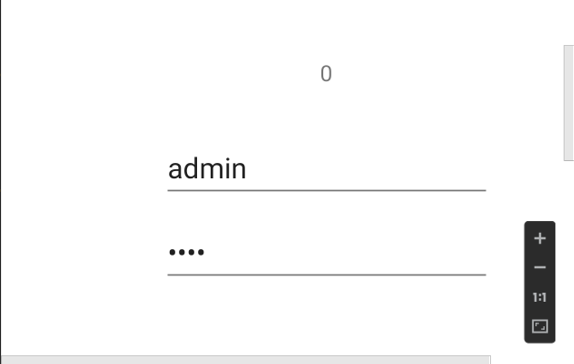
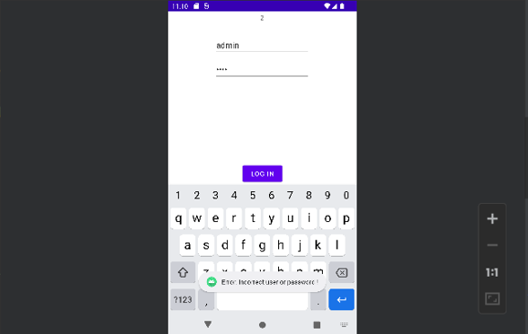
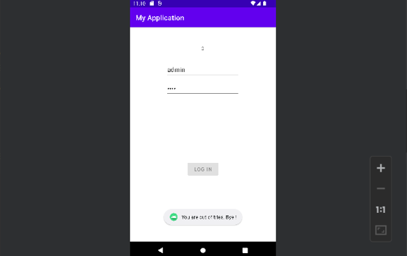

# Sistem de autentificare Android

## 🇷🇴 Română

### 1. Descriere

Sistem de autentificare Android este o aplicație mobilă dezvoltată în Java, folosind Android Studio. Aplicația implementează un sistem simplu de autentificare pe bază de nume de utilizator și parolă, cu un număr limitat de încercări.

Utilizatorul poate introduce datele de autentificare, iar aplicația verifică dacă acestea corespund cu datele prestabilite. Sunt permise maximum trei încercări de autentificare. După trei încercări nereușite, butonul de autentificare este dezactivat.

## 2. Funcționalități

- Interfață grafică simplă și intuitivă.
- Câmp pentru introducerea numelui de utilizator.
- Câmp pentru introducerea parolei, cu caractere mascate.
- Verificarea datelor de autentificare.
- Limitarea numărului de încercări la maximum trei.
- Afișarea numărului de încercări rămase.
- Afișarea mesajelor de succes sau eroare folosind Toast.
- Dezactivarea butonului de autentificare după trei încercări nereușite.

## 3. Tehnologii utilizate

- **Java** – limbajul de programare utilizat pentru implementarea logicii aplicației.
- **Android Studio** – mediul de dezvoltare utilizat pentru realizarea aplicației.
- **Android SDK** – instrumentele necesare dezvoltării aplicațiilor Android.
- **XML** – utilizat pentru definirea interfeței grafice.
- **ConstraintLayout** – utilizat pentru organizarea și poziționarea componentelor interfeței.
- **Android Views** – componente grafice precum Button, EditText și TextView.

## 4. Capturi de ecran

Capturile de ecran prezintă interfața aplicației și principalele situații de utilizare.

### Interfața principală



### Autentificare reușită


### Autentificare eșuată



### Încercări epuizate



## 5. Logica de funcționare

### 5.1. Inițializarea componentelor

La pornirea aplicației, componentele interfeței grafice sunt asociate cu variabilele din clasa MainActivity folosind metoda `findViewById()`.

```java
// Asocierea componentelor din interfața XML
butonAutentificare = findViewById(R.id.butonAutentificare);
campUtilizator = findViewById(R.id.campUtilizator);
campParola = findViewById(R.id.campParola);
numarIncercari = findViewById(R.id.textNumarIncercari);

// Inițializarea numărului de încercări
Integer contor = 3;
numarIncercari.setText(Integer.toString(contor));
```

### 5.2. Verificarea datelor de autentificare

Datele introduse de utilizator sunt preluate din câmpurile de text și verificate prin intermediul unei structuri condiționale `if/else`.

```java
// Preluarea datelor introduse
utilizator = campUtilizator.getText().toString().trim();
parola = campParola.getText().toString().trim();

// Verificarea datelor de autentificare
if (utilizator.equals("admin") && parola.equals("admin")) {

    Toast.makeText(getBaseContext(),"Autentificare reușită!",Toast.LENGTH_SHORT).show();

} else {

    // Scăderea numărului de încercări
    contor--;
}
```

### 5.3. Gestionarea încercărilor de autentificare

Aplicația permite maximum trei încercări. La fiecare autentificare nereușită, contorul este decrementat. Când acesta ajunge la zero, butonul de autentificare este dezactivat.

```java
// Verificarea numărului de încercări rămase
if (contor == 0) {

    // Dezactivarea butonului de autentificare
    butonAutentificare.setEnabled(false);

    // Actualizarea numărului de încercări
    numarIncercari.setText(Integer.toString(contor));

    Toast.makeText( getBaseContext(),"Ați epuizat toate încercările!",Toast.LENGTH_SHORT).show();

} else {

    // Actualizarea numărului de încercări rămase
    numarIncercari.setText(Integer.toString(contor));
}
```

## 6. Definirea interfeței grafice

Interfața aplicației este realizată folosind XML și ConstraintLayout.

Aceasta conține trei componente principale:

- **TextView** – afișează numărul de încercări rămase.
- **EditText** – permite introducerea numelui de utilizator.
- **EditText** – permite introducerea parolei, cu caractere mascate.
- **Button** – permite inițierea procesului de autentificare.

Exemplu de definire a câmpurilor de introducere:

```xml
<!-- Câmp pentru numele de utilizator -->
<EditText
    android:id="@+id/campUtilizator"
    android:layout_width="wrap_content"
    android:layout_height="wrap_content"
    android:hint="Nume utilizator"
    android:inputType="textPersonName" />

<!-- Câmp pentru parolă -->
<EditText
    android:id="@+id/campParola"
    android:layout_width="wrap_content"
    android:layout_height="wrap_content"
    android:hint="Parolă"
    android:inputType="textPassword" />
```

## 7. Date de autentificare

Pentru testarea aplicației sunt utilizate următoarele date:

| Câmp | Valoare |
|---|---|
| Nume utilizator | `admin` |
| Parolă | `admin` |
| Număr maxim de încercări | `3` |

## 8. Instalare și rulare

Pentru a instala și rula aplicația, urmează pașii:

1. Descarcă și instalează [Android Studio].
2. Clonează repository-ul:

   ```bash
   git clone https://github.com/IonutD3/Sistem-Autentificare-Android.git
   ```

3. Deschide Android Studio.
4. Selectează opțiunea **Open** și alege folderul proiectului.
5. Așteaptă finalizarea sincronizării Gradle.
6. Pornește un emulator Android sau conectează un dispozitiv Android.
7. Apasă butonul **Run** pentru a instala și porni aplicația.

## 9. Structura proiectului

```text
Sistem-Autentificare-Android/
│
├── README.md
├── build.gradle
├── gradle.properties
├── gradlew
├── gradlew.bat
├── settings.gradle
│
├── Images/
│   ├── interfata-principala.png
│   ├── autentificare-reusita.png
│   ├── autentificare-esuata.png
│   └── incercari-epuizate.png
│
├── gradle/
│   └── wrapper/
│       ├── gradle-wrapper.jar
│       └── gradle-wrapper.properties
│
└── app/
    │
    ├── build.gradle
    ├── proguard-rules.pro
    │
    └── src/
        └── main/
            │
            ├── AndroidManifest.xml
            │
            ├── java/
            │   └── com/
            │       └── example/
            │           └── myapplication/
            │               └── MainActivity.java
            │
            └── res/
                │
                ├── drawable/
                │   └── ic_launcher_background.xml
                │
                ├── drawable-v24/
                │   └── ic_launcher_foreground.xml
                │
                ├── layout/
                │   └── activity_main.xml
                │
                ├── mipmap-anydpi-v26/
                │   ├── ic_launcher.xml
                │   └── ic_launcher_round.xml
                │
                ├── mipmap-hdpi/
                │   ├── ic_launcher.webp
                │   └── ic_launcher_round.webp
                │
                ├── mipmap-mdpi/
                │   ├── ic_launcher.webp
                │   └── ic_launcher_round.webp
                │
                ├── mipmap-xhdpi/
                │   ├── ic_launcher.webp
                │   └── ic_launcher_round.webp
                │
                ├── mipmap-xxhdpi/
                │   ├── ic_launcher.webp
                │   └── ic_launcher_round.webp
                │
                ├── mipmap-xxxhdpi/
                │   ├── ic_launcher.webp
                │   └── ic_launcher_round.webp
                │
                ├── values/
                │   ├── colors.xml
                │   ├── strings.xml
                │   └── themes.xml
                │
                └── values-night/
                    └── themes.xml
```

## 10. Scopul proiectului

Prin implementarea acestei aplicații au fost exersate:
- Utilizarea componentelor grafice Android.
- Gestionarea evenimentelor prin intermediul ascultătorilor de evenimente.
- Utilizarea structurilor condiționale.
- Preluarea și verificarea datelor introduse de utilizator.
- Gestionarea unui contor și actualizarea dinamică a interfeței.

## 11. Observații

Aplicația utilizează date de autentificare definite direct în cod (`admin` / `admin`).

---

# Android Login System

## 🇬🇧 English

### 1. Description

Android Login System is a mobile application developed in Java using Android Studio. The application implements a simple username and password authentication system with a limited number of login attempts.

Users can enter their login credentials, and the application checks whether they match the predefined credentials. A maximum of three login attempts is allowed. After three unsuccessful attempts, the login button is disabled.

## 2. Features

- Simple and intuitive graphical user interface.
- Username input field.
- Password input field with hidden characters.
- Login credential validation.
- Maximum of three login attempts.
- Display of remaining login attempts.
- Success and error notifications using Toast messages.
- Login button disabled after three unsuccessful attempts.

## 3. Technologies Used

- **Java** – programming language used to implement the application logic.
- **Android Studio** – development environment used to build the application.
- **Android SDK** – tools required for Android application development.
- **XML** – used to define the graphical user interface.
- **ConstraintLayout** – used to organize and position interface components.
- **Android Views** – graphical components such as Button, EditText, and TextView.

## 4. Screenshots

The screenshots illustrate the application interface and its main usage scenarios.

### Main Interface


### Successful Authentication


### Failed Authentication


### Login Attempts Exhausted


## 5. Application Logic

### 5.1. Component Initialization

When the application starts, the graphical interface components are associated with variables in the MainActivity class using the `findViewById()` method.

```java
// Associating XML interface components
butonAutentificare = findViewById(R.id.butonAutentificare);
campUtilizator = findViewById(R.id.campUtilizator);
campParola = findViewById(R.id.campParola);
numarIncercari = findViewById(R.id.textNumarIncercari);

// Initializing the number of attempts
Integer contor = 3;
numarIncercari.setText(Integer.toString(contor));
```

### 5.2. Login Credential Validation

The entered credentials are retrieved from the text fields and checked using an `if/else` conditional statement.

```java
// Retrieving the entered credentials
utilizator = campUtilizator.getText().toString().trim();
parola = campParola.getText().toString().trim();

// Checking the login credentials
if (utilizator.equals("admin") && parola.equals("admin")) {

    Toast.makeText(getBaseContext(),"Login successful!",Toast.LENGTH_SHORT).show();

} else {

    // Decreasing the number of remaining attempts
    contor--;
}
```

### 5.3. Login Attempt Management

The application allows a maximum of three login attempts. Each unsuccessful login decreases the counter by one. When the counter reaches zero, the login button is disabled.

```java
// Checking the number of remaining attempts
if (contor == 0) {

    // Disabling the login button
    butonAutentificare.setEnabled(false);

    // Updating the displayed number of attempts
    numarIncercari.setText(Integer.toString(contor));

    Toast.makeText(getBaseContext(),"You have used all your attempts!",Toast.LENGTH_SHORT).show();

} else {

    // Updating the remaining attempts
    numarIncercari.setText(Integer.toString(contor));
}
```

## 6. User Interface Design

The application interface is built using XML and ConstraintLayout.

It contains four main components:

- **TextView** – displays the number of remaining attempts.
- **EditText** – allows the user to enter a username.
- **EditText** – allows the user to enter a password with hidden characters.
- **Button** – starts the authentication process.

Example of the input fields:

```xml
<!-- Username input field -->
<EditText
    android:id="@+id/campUtilizator"
    android:layout_width="wrap_content"
    android:layout_height="wrap_content"
    android:hint="Username"
    android:inputType="textPersonName" />

<!-- Password input field -->
<EditText
    android:id="@+id/campParola"
    android:layout_width="wrap_content"
    android:layout_height="wrap_content"
    android:hint="Password"
    android:inputType="textPassword" />
```

## 7. Login Credentials

The following credentials can be used to test the application:

| Field | Value |
|---|---|
| Username | `admin` |
| Password | `admin` |
| Maximum login attempts | `3` |

## 8. Installation and Setup

To install and run the application, follow these steps:

1. Download and install [Android Studio].
2. Clone the repository:

   ```bash
   git clone https://github.com/IonutD3/Sistem-Autentificare-Android.git
   ```

3. Open Android Studio.
4. Select **Open** and choose the project folder.
5. Wait for Gradle synchronization to finish.
6. Start an Android emulator or connect an Android device.
7. Click the **Run** button to install and launch the application.

## 9. Project Structure

```text
Sistem-Autentificare-Android/
│
├── README.md
├── build.gradle
├── gradle.properties
├── gradlew
├── gradlew.bat
├── settings.gradle
│
├── Images/
│   ├── interfata-principala.png
│   ├── autentificare-reusita.png
│   ├── autentificare-esuata.png
│   └── incercari-epuizate.png
│
├── gradle/
│   └── wrapper/
│       ├── gradle-wrapper.jar
│       └── gradle-wrapper.properties
│
└── app/
    │
    ├── build.gradle
    ├── proguard-rules.pro
    │
    └── src/
        └── main/
            │
            ├── AndroidManifest.xml
            │
            ├── java/
            │   └── com/
            │       └── example/
            │           └── myapplication/
            │               └── MainActivity.java
            │
            └── res/
                │
                ├── drawable/
                │   └── ic_launcher_background.xml
                │
                ├── drawable-v24/
                │   └── ic_launcher_foreground.xml
                │
                ├── layout/
                │   └── activity_main.xml
                │
                ├── mipmap-anydpi-v26/
                │   ├── ic_launcher.xml
                │   └── ic_launcher_round.xml
                │
                ├── mipmap-hdpi/
                │   ├── ic_launcher.webp
                │   └── ic_launcher_round.webp
                │
                ├── mipmap-mdpi/
                │   ├── ic_launcher.webp
                │   └── ic_launcher_round.webp
                │
                ├── mipmap-xhdpi/
                │   ├── ic_launcher.webp
                │   └── ic_launcher_round.webp
                │
                ├── mipmap-xxhdpi/
                │   ├── ic_launcher.webp
                │   └── ic_launcher_round.webp
                │
                ├── mipmap-xxxhdpi/
                │   ├── ic_launcher.webp
                │   └── ic_launcher_round.webp
                │
                ├── values/
                │   ├── colors.xml
                │   ├── strings.xml
                │   └── themes.xml
                │
                └── values-night/
                    └── themes.xml
```

## 10. Project Purpose

Through this application, the following concepts were practiced:
- Using Android graphical components.
- Handling events through event listeners.
- Working with conditional statements.
- Retrieving and validating user input.
- Managing a counter and dynamically updating the interface.

## 11. Note

The application uses hardcoded login credentials (`admin` / `admin`). 

---

## 👤 Autor / Author

**IonutD**
